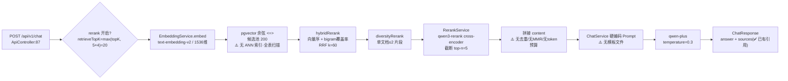
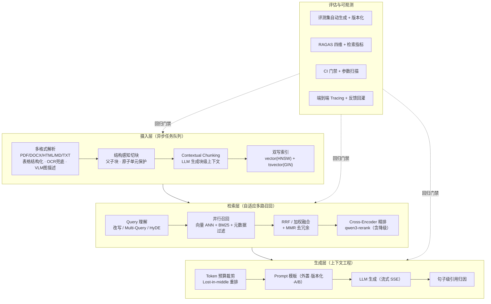
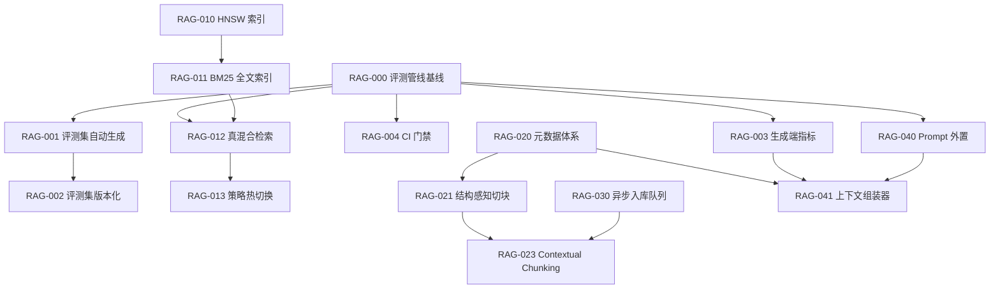

# 07 RAG 升级改造产品需求与任务清单

> 版本：v1.1（开发中）
> 创建日期：2026-10-15
> 配套文档：`00_头脑风暴文档.md`、`03_数据架构设计文档.md`、`05_技术架构设计文档.md`、`05.3_模块详细设计.md`、`06_功能清单进度文档.md`
> 代码基线：Spring Boot 3.2.5 / Java 17 / PostgreSQL+pgvector / Redis / 阿里云百炼
> 文档状态：🔄 持续更新（M1 进行中）
> 任务状态图例：✅ 已完成　♋ 进行中　❌ 未开始（含后续 Epic）
> 优先级图例：**P0** 必做（阻塞效果与规模化）　**P1** 应做（体验与成本）　**P2** 探索（差异化与前沿）
> 收益图例：🔥 高　☀️ 中　🌙 低
> 风险图例：🔴 高　🟡 中　🟢 低

---

## 0.1 执行进度总览（2026-10-15）

| 里程碑 | 任务 | 状态 |
|---|---|---|
| **M1 地基** | RAG-010 HNSW 索引 | ✅ |
| | RAG-011 中文分词与 BM25 全文索引 | ✅ |
| | RAG-012 真混合检索 | ✅ |
| | RAG-013 策略可配置化与热切换 | ✅ |
| | RAG-020 Chunk/Document 元数据体系 | ✅ |
| | RAG-021 结构感知切块 | ✅ |
| | RAG-030 异步入库任务队列 | ✅ |
| | RAG-000 自动评测管线与基线快照 | ✅ |
| | RAG-001 评测集自动生成 | ✅ |
| | RAG-002 评测集版本化管理 | ✅ |
| | RAG-003 生成端评估指标 | ✅ |
| | RAG-004 CI 回归门禁 | ✅ |
| **M2 质量跃迁** | RAG-023 Contextual Chunking | ✅ |
| | RAG-040 Prompt 外置与版本化 | ✅ |
| | RAG-041 上下文组装器 | ✅ |
| **M3 体验与成本** | RAG-022/025/026/042/044/046、RAG-051~055（RAG-043 流式已完成 ✅） | ❌ |

> **P0（M1）13 项 + M2 全部完成，RAG-043 流式已完成。** 下一步建议：M3 其余体验项（RAG-042 引用归因 / RAG-044 多轮），
> 或 M2 的 P1 质量项（RAG-015 查询改写 / RAG-018 MMR / RAG-050 缓存）。

**顺带修复的预存缺陷**：
1. `pom.xml` 未声明 `project.build.sourceEncoding`，javac 在中文 Windows 上按 GBK 读取 UTF-8 源码，导致所有中文字面量被破坏（日志/异常/测试断言乱码）。已补 UTF-8 声明 + surefire `file.encoding` + 运行期 `-Dfile.encoding=UTF-8`。
2. `ContextAssembler.reorder` 初版 U 型重排逻辑错误（最相关片段落在第 4 位），已改为「偶数位取头、奇数位取尾」的正确实现。
3. 异步入库在 `@Transactional` 方法内直接 `executor.execute`，工作线程早于事务提交执行导致 `findById` 返回 null、任务被静默丢弃（且误删临时文件）。已改为注册 `afterCommit` 回调。

**测试状态**：`mvn test` 共 173 个用例，新增 69 个纯逻辑单测（分块/元数据/上下文组装/Prompt 渲染/judge 解析/抽样/评测集生成/上下文前缀）全绿；剩余 72 个 error 为**预存环境问题**（Maven 使用 JDK 25，Mockito inline mock maker 无法在该 JVM 修改类），与本次改动无关。

**端到端验证（真实 PostgreSQL + pgvector 0.7.4 + 真实启动）**：应用成功启动、9 项 schema 迁移全部生效、HNSW 索引就绪；上传返回 taskId 即时响应 → 后台执行 → 失败带明确原因 → 重试后 `retryCount` 递增并重新执行 → 重启恢复正确识别丢失的临时文件；评测集创建/导出/运行历史接口均返回正确结构；Contextual BM25 实测：查询仅存在于前缀的词可命中原文完全没有该词的 chunk，且迁移重跑不重写表、存量无前缀行正常切词。全链路已实测通过。

---

## 0 摘要（TL;DR）

qoorag 当前的 RAG 链路是**"Naive RAG + 两处局部增强"**：固定字符数切块 → 百炼 embedding → pgvector 余弦检索 → 自研 bigram-RRF 重排 → 百炼 cross-encoder 精排 → 硬编码 Prompt → qwen-plus 生成。链路可跑通、租户隔离与审计齐备，但**在"检索质量、知识表示、可评估性"三个维度上停留在 2024 年水平**，与 2026 年主流企业 RAG（结构感知摄入 + 混合检索 + 上下文工程 + 自动化评测闭环）存在代际差。

本清单基于**代码实证的 14 项差距**与**业界 2026 前沿实践对标**，给出 **6 个 Epic / 34 个需求项 / 78 个可落地任务**，并明确优先级、工作量、验收标准与里程碑。

**三个核心判断：**

| # | 判断 | 依据 |
|---|---|---|
| 1 | **最大的短板不是"检索算法"，而是"知识表示"**——`Chunk` 只有 `seq + content`，零元数据；切块是按 400/100/500 字符硬切 | `IngestService.java:30-32, 143-191`；`entity/Chunk.java` |
| 2 | **当前"混合检索"是伪混合**——只有向量 + 自造 bigram 覆盖率 RRF，没有真 BM25/词法索引；且 `sql/init.sql:124-131` 的 HNSW/IVFFlat 索引被注释，向量检索是**全表顺序扫描** | `RetrieveService.java:199-294`；`sql/init.sql` |
| 3 | **没有"可信的评估闭环"**——评测集是 1 份手写 JSON 且全部为文档级标注，生成端无任何指标（无 Faithfulness/幻觉率），改任何参数都靠人肉跑 PowerShell 脚本 | `scripts/eval/qoorag-eval-dataset.json`；`RetrievalEvalService.java` |

**建议节奏：** M1（P0，约 4 周）先补"索引 + 元数据 + 评测闭环"三块地基，M2（P1，约 6 周）做"摄入与检索质量跃迁"，M3（P2，约 8 周）探索"多模态 + 图谱 + Agentic"。

---

## 1 现状诊断

### 1.1 当前检索链路（代码实证）

### 1.2 能力成熟度评分

按 2026 年企业 RAG 能力模型自评（5 分制，★=1 分，☆=0.5 分）：

| 能力域 | 细分项 | 现状 | 业界 2026 主流 | 差距 |
|---|---|---|---|---|
| **知识摄入** | 格式覆盖（TXT/MD/PDF） | ★★☆☆☆ | ★★★★★（PDF/DOCX/HTML/PPT/表格/扫描件OCR） | 🟡 |
| | 结构感知解析 | ☆☆☆☆☆ | ★★★★☆（版面分析、标题层级、表格结构化） | 🔴 |
| | 切块策略 | ★☆☆☆☆（400/100/500 字符硬切） | ★★★★☆（语义/结构/父子块/Late Chunking） | 🔴 |
| | Chunk 元数据 | ☆☆☆☆☆（仅 seq） | ★★★★☆（标题路径/页码/偏移/类型/token数） | 🔴 |
| **索引** | 向量索引 | ☆☆☆☆☆（无 ANN，全表扫描） | ★★★★★（HNSW + 参数调优） | 🔴 |
| | 词法/BM25 索引 | ☆☆☆☆☆（不存在） | ★★★★★（tsvector/BM25 + GIN） | 🔴 |
| | Embedding 可演进 | ★★☆☆☆（全局维度，换模型需空表） | ★★★★☆（多版本共存 + 灰度迁移） | 🟡 |
| **检索** | 多路召回融合 | ★★☆☆☆（向量+bigram RRF，非真 BM25） | ★★★★☆（BM25+向量+关键词 RRF/加权） | 🔴 |
| | 精排 Rerank | ★★★★☆（qwen3-rerank，有降级） | ★★★★☆ | 🟢 |
| | 查询变换 | ☆☆☆☆☆（原始 query 直检） | ★★★★☆（改写/Multi-Query/HyDE/Step-back） | 🔴 |
| | 自适应检索 | ☆☆☆☆☆ | ★★★☆☆（Self-RAG/CRAG 按置信度决策） | 🟡 |
| **生成** | Prompt 管理 | ★☆☆☆☆（硬编码在 Java 里） | ★★★★☆（模板外置 + 版本化 + A/B） | 🔴 |
| | 上下文工程 | ★☆☆☆☆（裸拼接） | ★★★★☆（去重/MMR/token预算/Lost-in-middle 重排） | 🔴 |
| | 引用归因 | ★★★☆☆（有 sources，无精确 span 定位） | ★★★★☆（句子级归因 + 可点击溯源） | 🟡 |
| | 流式输出 | ☆☆☆☆☆ | ★★★★☆（SSE） | 🟡 |
| | 多轮对话 | ☆☆☆☆☆（无会话历史） | ★★★★☆ | 🟡 |
| **评估** | 检索端指标 | ★★★☆☆（Recall/Precision/HitRate/MRR） | ★★★★☆ | 🟢 |
| | 生成端指标 | ☆☆☆☆☆（无 Faithfulness/幻觉率） | ★★★★☆（RAGAS 四维 + LLM-as-judge） | 🔴 |
| | 评测集 | ★☆☆☆☆（1 份手写 JSON，全文档级标注） | ★★★★☆（自动生成 + 人工校准 + 版本化） | 🔴 |
| | CI 回归门禁 | ☆☆☆☆☆（人肉跑 PowerShell） | ★★★★☆（自动化 + 阈值门禁） | 🔴 |
| **工程** | 异步入库 | ☆☆☆☆☆（上传请求内同步阻塞） | ★★★★☆（任务队列 + 进度可查） | 🔴 |
| | 缓存 | ☆☆☆☆☆（Redis 仅用于会话/限流） | ★★★☆☆（embedding 缓存 + 语义查询缓存） | 🟡 |
| | 可观测 Tracing | ★★☆☆☆（Micrometer 基础指标） | ★★★★☆（单次问答全链路 Trace） | 🟡 |

**综合：当前处于 L1（Naive RAG）向 L2（Advanced RAG）过渡的早期，检索端已做 2 处增强，其余维度基本空白。**

### 1.3 关键差距清单（GAP）

| GAP-ID | 差距 | 代码位置 | 业务影响 | 严重度 |
|---|---|---|---|---|
| GAP-01 | 无 ANN 索引，向量检索全表顺序扫描 | `sql/init.sql:124-131`（HNSW/IVFFlat 被注释） | 数据量上万后 P95 延迟不可用 | 🔴 |
| GAP-02 | 无真 BM25/词法索引，无 tsvector/GIN | 全库零命中 | 专有名词/型号/编号/缩写类 query 召回差 | 🔴 |
| GAP-03 | Chunk 零元数据（仅 seq+content） | `entity/Chunk.java` | 无法溯源页码/标题、无法做结构化过滤与引用展示 | 🔴 |
| GAP-04 | 固定字符数切块，无结构/语义感知 | `IngestService.splitText()` | 表格被压扁、语义单元被切断、上下文缺失 | 🔴 |
| GAP-05 | 生成端零评估指标（无幻觉率/忠实度） | `RetrievalEvalService.java` | 无法量化"答案是否编造"，无法对比 Prompt/模型改动 | 🔴 |
| GAP-06 | 评测集手写且全文档级标注，无自动生成 | `scripts/eval/qoorag-eval-dataset.json` | 评测集不可扩展，标注粒度粗导致指标虚高（已有 `loopSuspected` 告警） | 🔴 |
| GAP-07 | 无查询变换（改写/HyDE/Multi-Query） | `RetrieveService.retrieve()` 直接用原 query | 口语化/指代/短 query 召回差 | 🔴 |
| GAP-08 | Prompt 硬编码在 Java 字符串里 | `ChatService.java:55-64` | 改 Prompt 需发版，无法 A/B，无法按 KB 定制 | 🔴 |
| GAP-09 | 上下文裸拼接，无去重/MMR/token 预算 | `ApiController.java:114-116` | 冗余片段挤占上下文、token 浪费、中间信息丢失 | 🔴 |
| GAP-10 | 入库同步阻塞在上传请求内 | `IngestService.ingest()` `@Transactional` | 大文档超时、无进度、无重试、失败即整篇重来 | 🔴 |
| GAP-11 | 仅 TXT/MD/PDF，无 DOCX/HTML，无 OCR/表格/图片 | `DocumentParserService.java`、`DocumentController.java:70` | 企业真实文档（docx/扫描件/表格）大量不可入库 | 🟡 |
| GAP-12 | 无缓存层（embedding 与 query 结果均未缓存） | `EmbeddingService.java` | 重复 query 反复付费调 API，热点问题成本高 | 🟡 |
| GAP-13 | Embedding 维度全局唯一，换模型需空表重建 | `VectorDimensionReconciler.java` | 无法灰度升级 embedding 模型，升级即停机 | 🟡 |
| GAP-14 | 无多轮对话 / 无流式输出 | `ApiController.chat()` | 用户体验落后，无法做追问与长答案 | 🟡 |

---

## 2 业界前沿实践对标（2026）

> 本节为需求来源的"外部依据"。每项标注：**业界做法 / qoorag 现状 / 预期收益 / 落地成本 / 采纳优先级**。

### 2.1 摄入与知识表示层

| 前沿实践 | 业界做法（2026 主流） | qoorag 现状 | 收益 | 成本 | 优先级 |
|---|---|---|---|---|---|
| **Contextual Retrieval / Contextual Chunking** | Anthropic：入库时用轻量 LLM 为每个 chunk 生成 50-100 字"该块在原文中的位置与上下文"描述，前置拼到 embedding 与 BM25 文本前。官方实测：Contextual Embedding 使 top-20 召回失败率 5.7%→3.7%（-35%）；叠加 Contextual BM25 为 -49%；再叠加 rerank 累计 **-67%** | 无。chunk 就是裸文本 | 🔥 单项收益最大的摄入侧改动，且**只影响离线入库、不增加在线延迟** | 中（入库需多一轮 LLM 调用，可用 prompt caching / 小模型降本） | **P0** |
| **结构感知切块** | 按 Markdown 标题层级 / 文档大纲切分；表格、代码块、列表作为**原子单元**不切断；块内保留 `heading_path` | 按 `\n\n+` 分段 + 句末标点切句 + 400 字符硬切 | 🔥 直接解决 GAP-04 | 低 | **P0** |
| **父子块 / Small-to-Big** | 小块（句子/段落）用于检索保证精度，命中后回填父块（章节）用于生成保证上下文完整 | 无，检索块 = 生成块 | 🔥 同时提升 Precision 与答案完整性 | 中（需改 schema + 检索回填逻辑） | **P1** |
| **Late Chunking** | 先对整篇做长上下文 embedding，再在 token 层面切块取均值——保留全局上下文，避免块级上下文丢失 | 无 | ☀️ 对长文档有效 | 高（需支持长上下文 embedding 模型） | P2 |
| **多模态文档解析** | 版面分析（LayoutLMv3 / PP-Structure）→ 表格转结构化 JSON 独立索引 → 图片/图表用 VLM 生成描述 → 扫描件走 OCR（PaddleOCR/Tesseract 双引擎兜底） | PDFBox 纯文本抽取，扫描件直接报错，表格图片全部丢弃 | 🔥 企业真实文档覆盖率从 ~40% 提至 >90% | 高 | **P1（表格）/ P2（VLM+OCR）** |
| **ColPali / Late Interaction** | 页面图像直接送 VLM 生成 multi-vector，MaxSim 细粒度匹配，跳过 OCR→版面重建→切块的脆弱管线 | 无 | ☀️ 视觉文档检索 SOTA | 高（需新索引形态） | P2 |

### 2.2 索引与检索层

| 前沿实践 | 业界做法 | qoorag 现状 | 收益 | 成本 | 优先级 |
|---|---|---|---|---|---|
| **HNSW ANN 索引 + 参数调优** | `CREATE INDEX ... USING hnsw (embedding vector_cosine_ops) WITH (m=16, ef_construction=64~200)`；查询期 `SET hnsw.ef_search=40~100` 权衡召回/延迟；注意**大量删除后需 VACUUM**，否则召回率可从 95% 跌至 18% | **索引被注释，全表顺序扫描** | 🔥 数据量增长的唯一前提 | 低 | **P0** |
| **真 BM25 + 向量 RRF/加权混合** | PostgreSQL `tsvector` + GIN 索引 + `ts_rank_cd`；中文用 `zhparser`/`pg_jieba` 分词或 bigram 兜底；与向量做 RRF（k=60）或归一化加权融合 | 只有"向量 + 自造 bigram 覆盖率"的伪混合，且 bigram 覆盖率**无 IDF 权重**，长短文档不公平 | 🔥 专名/型号/编号类 query 的救命稻草 | 中（需引入中文分词或评估 bigram+IDF 折中） | **P0** |
| **Query 变换** | ① LLM 查询改写（消歧/补全指代）② Multi-Query / RAG-Fusion（生成 3-5 个变体并行检索再 RRF 融合）③ HyDE（生成假设答案再检索）④ Step-back（抽象为更高层问题） | 原始 query 直接 embedding | 🔥 短 query/口语化 query 收益显著 | 中（每次多 1 次 LLM 调用，可按需开关） | **P1** |
| **Adaptive / Self-RAG / CRAG** | 按 query 复杂度与首轮检索置信度决策：是否需要检索、是否需要改写重检、是否需要补充外部检索 | 固定单次检索 | ☀️ 复杂 query 准确率提升，简单 query 降本 | 高 | P2 |
| **Matryoshka 嵌套向量** | text-embedding-v3/v4 支持维度裁剪，用短维度做粗排、长维度做精排，存储与算力分层 | 无（1536 维全量） | ☀️ 存储/检索成本可降 50%+ | 中 | P2 |
| **GraphRAG / LightRAG** | 抽取实体关系建图，支持跨文档多跳关系推理；轻量版（LightRAG）只做双层检索降本 | 无 | ☀️ 多跳/全局性问题（"对比 A 与 B 的差异"）独有价值 | 高 | P2 |
| **RAPTOR 层次摘要树** | 对文档聚类递归摘要，建树状索引，兼顾细节与全局 | 无 | ☀️ 全局摘要类问题 | 高 | P2 |

### 2.3 生成与上下文工程层

| 前沿实践 | 业界做法 | qoorag 现状 | 收益 | 成本 | 优先级 |
|---|---|---|---|---|---|
| **Prompt 外置 + 版本化 + A/B** | 模板文件化（DB 或 `resources/prompts/`），支持按 KB/场景选择模板、灰度与效果对比 | 硬编码在 `ChatService.java` | 🔥 迭代速度量级提升，是后续所有 Prompt 优化的前提 | 低 | **P0** |
| **上下文工程** | ① 去重（相似度/内容哈希）② MMR 去冗余 ③ Token 预算裁剪 ④ 应对 "Lost in the Middle"：高相关片段放首尾 ⑤ 片段加标题/来源前缀 | 裸拼接 `content` | 🔥 直接提升答案质量并降 token 成本 | 低 | **P0** |
| **引用归因（Citation）** | 句子级归因：答案每句标注来源 chunk_id，前端可点击跳转原文定位 | 有 `sources[]`（documentId/chunkId/seq/score/snippet），但非句子级 | 🔥 企业级可信度刚需 | 中 | **P1** |
| **流式输出（SSE）** | `SseEmitter` / `Flux` 流式返回，先出 token 后出引用 | 无，同步阻塞 | ☀️ 首字延迟体验 | 低 | **P1** |
| **多轮对话记忆** | 会话历史 + 指代消解（"它怎么样？"→ 补全实体）+ 历史压缩 | 无 sessionId、无历史表 | ☀️ 追问场景刚需 | 中 | **P1** |

### 2.4 评估与可观测层

| 前沿实践 | 业界做法 | qoorag 现状 | 收益 | 成本 | 优先级 |
|---|---|---|---|---|---|
| **RAGAS 四维指标** | Faithfulness（答案是否由上下文推出）、Answer Relevancy、Context Precision、Context Recall；用 LLM-as-judge 打分 | 只有检索端 Recall/Precision/HitRate/MRR，**生成端零指标** | 🔥 唯一能回答"答案靠不靠谱"的手段 | 中 | **P0** |
| **评测集自动生成** | 用 LLM 从库内文档反向生成 query + 标注相关 chunk（chunk 级），人工抽检校准，版本化管理 | 1 份手写 JSON、全文档级标注 | 🔥 评测集规模与质量的瓶颈 | 中 | **P0** |
| **CI 回归门禁** | 每次 PR/发版自动跑评测，指标跌破阈值（如 Recall 降 >2pp）阻断合并；参数扫描脚本化 | 人肉执行 `scripts/eval/*.ps1` | 🔥 防止"改了变好、上线变差" | 低 | **P0** |
| **端到端 Tracing** | 单次问答全链路 Trace：query → 改写 → 召回 N 条（含分数）→ 精排 → 上下文组装 → Prompt → LLM → 引用，可回放可诊断 | 只有 Micrometer 聚合指标 | ☀️ 线上 badcase 归因效率 | 中 | **P1** |
| **线上反馈闭环** | 点赞/点踩 → 沉淀为 badcase → 回灌评测集 | 无 | ☀️ 持续进化 | 中 | P2 |

### 2.5 工程与成本层

| 前沿实践 | 业界做法 | qoorag 现状 | 收益 | 成本 | 优先级 |
|---|---|---|---|---|---|
| **异步入库任务队列** | 上传即返回，后台任务消费，支持进度查询/断点重试/失败原因可见 | 同步阻塞在 HTTP 请求内，单事务 | 🔥 大文档可用性 | 中 | **P0** |
| **Embedding / 查询缓存** | embedding 按内容哈希缓存；语义相似 query 结果缓存（可设 TTL） | 无 | ☀️ 热点 query 成本直降 | 低 | **P1** |
| **Rerank/LLM 降级与超时治理** | 分级超时、熔断、降级（已有 rerank 降级 ✅），补齐 LLM 超时与重试 | rerank 有降级，Chat 无超时/重试 | ☀️ 稳定性 | 低 | **P1** |
| **Embedding 版本化与灰度迁移** | 向量表记录 `embedding_model` + `version`，支持双写与灰度切流 | 全局单维度，换模型需空表 | ☀️ 模型升级不停机 | 中 | **P2** |

---

## 3 改造目标与度量基线

### 3.1 北极星指标

> **企业级知识问答的"可信答案率"**：在标准评测集上，`Recall@5 ≥ 95%` 且 `Faithfulness ≥ 0.90` 且 `Precision@5 ≥ 75%` 的 query 占比 ≥ 85%。

### 3.2 分层度量与基线/目标

| 层级 | 指标 | 当前基线 | M1 目标 | M2 目标 | 测量方式 |
|---|---|---|---|---|---|
| **检索** | Recall@5（chunk 级） | 未测（文档级 ≈93%） | ≥ 90% | ≥ 95% | 自动评测集 |
| | Precision@5 | 57.8%（hybrid 后） | ≥ 65% | ≥ 75% | 自动评测集 |
| | MRR | 有值未固化基线 | ≥ 0.80 | ≥ 0.85 | 自动评测集 |
| | HitRate@5 | 97% | ≥ 97% | ≥ 99% | 自动评测集 |
| **生成** | Faithfulness（忠实度） | **未测量** | ≥ 0.85 | ≥ 0.90 | LLM-as-judge 抽样 |
| | Answer Relevancy | **未测量** | ≥ 0.80 | ≥ 0.85 | LLM-as-judge 抽样 |
| | 幻觉率（答案含不可溯源断言） | **未测量** | ≤ 8% | ≤ 5% | 人工抽检 + judge |
| **性能** | 检索 P95 延迟（10 万向量/租户） | **未测量**（全表扫描） | ≤ 150ms | ≤ 100ms | 压测 |
| | 端到端 P95（非流式） | **未测量** | ≤ 4s | ≤ 3s | 压测 |
| | 入库吞吐（页/分钟） | **未测量** | ≥ 200 | ≥ 500 | 压测 |
| **成本** | 单次问答 LLM+Embedding+Rerank 成本 | **未测量** | 建立基线 | 较基线 -30% | 埋点统计 |
| **工程** | 评测自动化 | 人肉 | CI 一键跑 | PR 门禁 | 流水线 |
| | 入库失败可观测率 | 仅状态 FAILED | 含阶段+原因 | 含阶段+原因+重试 | 任务表 |

> ⚠️ **前置任务（RAG-000）**：上述多数指标当前**没有基线**。M1 第一周必须先建立"可复现的自动评测管线 + 基线快照"，否则后续所有优化都无法证明有效。

### 3.3 目标架构（M2 完成态）

---

## 4 需求任务清单

> 编号规则：`RAG-<Epic>-<序号>`。工作量单位为人日（含开发 + 自测，不含联调与评审）。
> 「验收标准」为可客观判定的完成条件；涉及指标的，以 §3.2 基线为前提。

---

### EPIC-1　评估与实验平台（先建尺子，再动刀）

> **为什么排第一**：GAP-05/06 指出当前无法量化生成质量、评测集不可扩展。没有这把尺子，EPIC-2/3/4 的所有优化都是"盲改"。

| 编号 | 需求/任务 | 优先级 | 工作量 | 验收标准 | 依赖 | 涉及代码 |
|---|---|---|---|---|---|---|
| **RAG-000** | **建立可复现的自动评测管线与基线快照** | **P0** ✅ | 5d | ① `mvn test` 或一条命令可跑完整评测并输出 JSON 报告；② 报告固化当前 Recall@5/P@5/MRR/HitRate 基线；③ 报告含环境指纹（embedding 模型、rerank 模型、参数快照） | — | `RetrievalEvalService`、`scripts/eval/` |
| | *实现说明* | | | | | 新增 `eval_run` 表 + `EvalRun` 实体 + `EvalRunService` + `EvalAdminController`。每次评测落库一条运行记录，含**环境指纹**（embedding/chat/rerank 模型 + 检索策略快照 + topK + rerank 开关），使指标可归因；自动与上一次成功运行对比并给出逐项增减（`delta`）；环境指纹变化时显式提示"差异可能来自配置而非代码"。接口：`POST /api/admin/eval/run`、`GET /api/admin/eval/runs`、`GET /api/admin/eval/compare`。**待办**：在配置了 API Key 的环境跑首次基线（RAG-004 的 `-UpdateBaseline`） |
| **RAG-001** | **评测集自动生成** | **P0** ✅ | 8d | ① 提供"按 KB 自动生成评测集"能力：从库内 chunk 反向生成 query，并标注**chunk 级**相关 ID；② 支持生成数量/难度分布配置；③ 输出格式兼容现有 `/api/admin/eval` 入参；④ 生成 200 条样本人工抽检准确率 ≥ 80% | RAG-000 | 新增 `EvalDatasetGenService`、`RetrievalEvalController` |
| | *实现说明* | | | | | 新增 `EvalDatasetGenService` + `POST /api/admin/eval/generate`。**跨文档分层抽样**（分轮抽取：保证每个有内容的文档至少 1 个最低代表性，同时占比趋向内容分布；固定种子 + seq 排序保证可复现）；对每个 chunk 调 LLM 反向生成最多 3 个问题；标注为 **chunk 级**（`relevantChunkIds=[该chunk]`），让 Precision@K 不再被文档级标注高估；`originQuery` 记录 chunk 摘要供人工抽检回溯。已知局限（已写入类注释与返回的 `qualityHint`）：测不出需多 chunk 联合的复杂问题，必须人工抽检补集。新增 11 个单测 |
| **RAG-002** | **评测集版本化管理** | P0 ✅ | 3d | ① 评测集落库（含版本号、KB、创建人、样本数）；② 支持按版本复跑并横向对比；③ 评测报告关联评测集版本 | RAG-001 | 新增 `eval_dataset` 表 |
| | *实现说明* | | | | | 新增 `eval_dataset` / `eval_dataset_item` 表 + `EvalDatasetService`。按 KB 自增版本号；条目支持 chunk 级 + 文档级标注混用（判定逻辑取并集，兼容既有习惯）；导出格式与 `POST /api/admin/eval` 的 `queries` 入参**完全一致**，现有 `scripts/eval/*.ps1` 无需改动即可继续使用。接口：`POST/GET/DELETE /api/admin/eval/datasets`、`GET .../export` |
| **RAG-003** | **生成端评估指标（RAGAS 四维）** | **P0** ✅ | 8d | ① 实现 Faithfulness / Answer Relevancy / Context Precision / Context Recall，用 LLM-as-judge 打分（judge 模型可配）；② 评测报告同时输出检索端与生成端指标；③ 与人工标注对比，judge 一致性（相关系数）≥ 0.7 | RAG-000 | 新增 `GenEvalService` |
| | *实现说明* | | | | | 新增 `GenEvalService`，实现 **Faithfulness**（答案拆句逐句判断是否被上下文支撑——整体判定会让一句幻觉被其余正确句稀释）与 **Answer Relevancy**（judge 打 1~5 归一化，是 RAGAS"生成反问问题再比对"的工程简化，省去二次生成）。Context Precision/Recall 字段已预留，待接入检索标注联合计算。**关键设计**：judge 失败时该指标返回 `null` 而非 0，上层不计入均值——避免把"没测到"误判成"质量差"；抽样比例（默认 30%）与最大调用数（50）可配，控制成本。新增 16 个单测。**待办**：judge 与人工标注的一致性校准 |
| **RAG-004** | **CI 回归门禁** | **P0** ✅ | 5d | ① PR/发版自动触发评测；② 指标跌破阈值（Recall 降 >2pp / Faithfulness 降 >0.05）阻断；③ 现有 `scripts/eval/*.ps1` 的扫描能力产品化（参数网格扫描 + 排行榜输出） | RAG-000, RAG-002 | CI 配置、`RetrievalEvalService` |
| | *实现说明* | | | | | 新增 `scripts/eval/run_eval_gate.ps1` + `scripts/eval/gate-thresholds.json`。流程：登录 → 触发评测（结果落库带环境指纹）→ 与基线 JSON 逐项对比 → 任一指标跌破阈值以退出码 1 阻断。阈值含**绝对下限 + 相对基线允许跌幅**双闸；环境指纹变化时告警（指标差异可能来自策略而非代码）；`-UpdateBaseline` 建立/更新基线；`trustworthy=false` 时提示标注污染风险。**待办**：接入具体 CI 平台（GitHub Actions / Jenkins）的 workflow 文件 |
| **RAG-005** | **评测结果可视化** | P1 | 5d | ① 管理后台新增"检索质量"页：历史评测趋势曲线、参数对比表、badcase 列表（query + 召回 + 标注）；② 支持导出 | RAG-002 | 新增 `eval.html` + 后端接口 |
| **RAG-006** | **端到端 Tracing** | P1 | 8d | ① 单次问答生成 traceId，落库全链路（query、改写结果、各路召回及分数、精排前后、上下文组装、Prompt、LLM 用量、引用）；② 管理端可按 traceId 回放；③ 支持按 KB/时间/低分筛选 | RAG-000 | 新增 `qa_trace` 扩展字段 / 新表 |
| **RAG-007** | **线上反馈回灌** | P2 | 5d | ① `/api/v1/chat` 支持 `feedback`（点赞/点踩 + 可选原因）；② 点踩样本自动进入 badcase 池并可一键加入评测集 | RAG-002, RAG-006 | `ApiController`、`ChatResponse` |

**EPIC-1 小计：P0 29d　P1 13d　P2 5d**

---

### EPIC-2　索引与检索升级（召回质量与性能）

| 编号 | 需求/任务 | 优先级 | 工作量 | 验收标准 | 依赖 | 涉及代码 |
|---|---|---|---|---|---|---|
| **RAG-010** | **启用 HNSW 向量索引并参数化** | **P0** ✅ | 3d | ① `sql/init.sql` 建立 HNSW（`vector_cosine_ops`，`m=16, ef_construction=128`）；② `hnsw.ef_search` 可配置（默认 40）；③ 10 万向量压测：Recall 相对暴力检索 ≥ 98%，P95 ≤ 150ms；④ 提供索引重建脚本与文档 | — | `sql/init.sql`、新增迁移脚本 |
| | *实现说明* | | | | | `PgvectorIndexMigrator`（`@Order(4)`）每次启动幂等建索引，存量库无需手工执行 SQL；`RetrieveService.queryVectorDb` 用「手动事务 + `SET LOCAL hnsw.ef_search`」把 GUC 约束在单连接单事务内，避免污染连接池。已在本地 pgvector 0.7.4 实测：索引建成、`SET LOCAL` 提交后自动失效。**待办**：10 万向量压测（RAG-055） |
| **RAG-011** | **中文分词与 BM25 全文索引** | **P0** ✅ | 8d | ① `chunk` 增加 `tsvector` 列（或生成列）+ GIN 索引；② 中文方案落地（优先 `pg_jieba`/`zhparser`，不可用时以 bigram+IDF 折中并在文档中说明理由）；③ 提供 `bm25_search(query, kb_id, tenant_id, limit)` 能力 | RAG-010 | `sql/init.sql`、`RetrieveService` |
| | *实现说明* | | | | | 镜像无 `pg_jieba`/`zhparser`（需自行编译），且 PG 默认分词器把整段 CJK 当单 token。采用 **自建 CJK 分词函数** `qoorag_cjk_tsvector/tsquery`（ASCII 词 + CJK 字符二元组）+ `tsv` **生成列** + GIN 索引 + `ts_rank_cd` 排序。已在真实库端到端验证：相关片段命中、无关片段排除、偏移正确。**取舍**：`ts_rank_cd` 非严格 BM25，但 RRF 只需名次；若要严格 BM25 只需替换 `LexicalSearchService` 内部实现，上层不变 |
| **RAG-012** | **真混合检索：BM25 + 向量融合** | **P0** ✅ | 8d | ① `RetrieveService` 支持 `fusion` 模式：`bm25 / vector / hybrid`（RRF k=60 或可配加权）；② 现有 `hybrid`（bigram-RRF）保留为 `legacy-hybrid` 供 A/B 对比；③ 评测集上 hybrid 相对纯向量的 Recall@5 提升 ≥ 5pp；④ 全部走 kb_id + tenant_id 隔离 | RAG-011、RAG-000 | `RetrieveService.java:148-224` |
| | *实现说明* | | | | | 新模式 `hybrid-rrf`（默认）：向量路（HNSW）+ 词法路（GIN/ts_rank_cd）**取并集**后按 RRF 名次融合，词法独有片段可进最终结果；改造前算法保留为 `legacy-hybrid`（已标 `@Deprecated`）仅供 A/B。**待办**：评测集量化提升幅度（依赖 RAG-000/001） |
| **RAG-013** | **检索策略可配置化与热切换** | P0 ✅ | 3d | ① 所有检索参数（fusion 模式、权重、候选池、min-score、topK、rerank top-n）支持**按 KB 配置并热生效**（当前 `overrideRerankConfig` 会污染全局单例，需修正为按 KB 上下文传参）；② 修正 `RetrieveService` 用可变字段承载请求级参数的线程安全问题 | RAG-012 | `RetrieveService.java:74-86` |
| | *实现说明* | | | | | 新增不可变 `RetrievalStrategy` record，检索入口改为 `retrieve(query, topK, kbId, tenantId, strategy)` 显式传参，彻底消除共享可变状态的线程竞争；`overrideRerankConfig` 标 `@Deprecated` 仅兼容旧评估接口。**待办**：按 KB 持久化策略表 + 热加载（需 `kb_retrieval_config` 表，建议并入 RAG-014） |
| **RAG-014** | **元数据过滤检索** | P1 | 5d | ① 支持按文档名/标签/时间范围/数据分级过滤召回；② 索引层保证过滤条件下仍能走 ANN（评估 partial index / 分区策略并写入文档） | RAG-020（元数据） | `RetrieveService`、`chunk` 表 |
| **RAG-015** | **查询改写（Query Rewriting）** | **P1** | 5d | ① 提供 `rewrite` 开关，用轻量 LLM 将 query 改写为检索友好形式（补全指代、展开缩写）；② 默认关闭，评测集上开启后 Recall@5 提升 ≥ 3pp 方可默认开启；③ 改写失败/超时静默降级为原 query | RAG-000 | 新增 `QueryTransformService` |
| **RAG-016** | **Multi-Query / RAG-Fusion** | P1 | 5d | ① 生成 3-5 个 query 变体并行检索，RRF 融合去重；② 开关默认关闭；③ 单次问答增加的成本与延迟可度量（写入 trace） | RAG-015、RAG-006 | `QueryTransformService` |
| **RAG-017** | **HyDE 假设文档检索** | P2 | 3d | ① 先用 LLM 生成假设答案，再用其 embedding 检索；② 开关默认关闭，评测对比后决定是否默认启用 | RAG-015 | `QueryTransformService` |
| **RAG-018** | **MMR 去冗余重排** | P1 | 3d | ① 在精排后、组装上下文前增加 MMR（λ 可配）；② 评测集上 Context Precision 提升 ≥ 3pp | RAG-012 | `RetrieveService` / 新增 `ContextAssembler` |
| **RAG-019** | **自适应检索（Adaptive-k）** | P2 | 8d | ① 按召回分数分布动态决定送入 LLM 的片段数（分数断崖式下降则截断）；② 相比固定 top-n=5，token 成本下降 ≥ 15% 且 Faithfulness 不降 | RAG-000、RAG-003 | `ApiController.java:104-111` |
| **RAG-100** | **Embedding 模型版本化与灰度迁移** | P2 | 13d | ① `vector_data` 增加 `embedding_model` + `dim` 列；② 支持双写与按 KB 灰度切流；③ 提供重建任务（不阻塞在线）；④ 换模型不再要求空表 | RAG-030（异步任务） | `VectorData`、`VectorDimensionReconciler`、`EmbeddingService` |

**EPIC-2 小计：P0 22d　P1 21d　P2 24d**

---

### EPIC-3　摄入与知识表示升级（决定召回上限）

| 编号 | 需求/任务 | 优先级 | 工作量 | 验收标准 | 依赖 | 涉及代码 |
|---|---|---|---|---|---|---|
| **RAG-020** | **Chunk / Document 元数据体系** | **P0** ✅ | 8d | ① `chunk` 增加：标题路径 `heading_path`、页码 `page_no`、字符区间 `char_start/char_end`、块类型 `chunk_type`（paragraph/table/code/list）、token 数、父块 ID；② `document` 增加：`source_uri`、`content_hash`、`mime_type`、`size`、`doc_title`、`page_count`、`parser`、`parser_version`；③ 提供存量数据回填脚本（默认填 seq 推导值）；④ 检索结果返回元数据 | — | `entity/Chunk`、`entity/Document`、`sql/init.sql` |
| | *实现说明* | | | | | `RagSchemaMigrator`（`@Order(6)`）幂等 ALTER 补列（存量库无需手工迁移）；实体新增全部字段；`tsv` 为**生成列**故不在 JPA 映射（避免写只读列）；检索结果已带 `headingPath/pageNo/chunkType/documentName`。**待办**：PDF 页号回填（需解析器输出页码，见 RAG-026）；存量数据回填脚本 |
| **RAG-021** | **结构感知切块** | **P0** ✅ | 8d | ① Markdown 按标题层级切分并保留 `heading_path`；② 表格/代码块/列表作为原子单元不被切断；③ 现有固定长度切块保留为 `fixed` 策略，新策略 `structure` 可配；④ 评测集上相对 `fixed` 的 Context Precision 提升 ≥ 5pp | RAG-020 | `IngestService.splitText()` |
| | *实现说明* | | | | | 新增 `structure` 策略（默认）：原子块识别（围栏代码 / Markdown 表格 / 列表）绝不切断；标题按 1~6 级维护**层级路径**（同级/更浅标题会弹出更深层级，避免章节泄漏）；标题不单独成块，仅作为后续块的 `heading_path`；`char_start/char_end` 为原文真实偏移（逐行推进偏移量，修复了初版"块长累加"导致偏移错位的 bug）。改造前算法保留为 `fixed` 策略。新增 11 个单测全绿（`IngestServiceChunkingTest`）。**待办**：Context Precision 量化对比（依赖 RAG-000/001） |
| **RAG-022** | **父子块（Small-to-Big）** | P1 | 8d | ① 建立子块（检索单元）与父块（生成单元）两级结构；② 检索命中子块后回填父块上下文送入 LLM；③ 评测集上 Faithfulness 或答案完整性人工评分提升 | RAG-020、RAG-021 | `chunk` 表、`RetrieveService` |
| **RAG-023** | **Contextual Chunking（块级上下文增强）** | **P0** ✅ | 8d | ① 入库时用轻量 LLM 为每个 chunk 生成 50-100 字上下文描述，前置拼接到 embedding 文本与 BM25 文本；② 开关可按 KB 配置（默认关闭，成本敏感）；③ 支持 prompt caching / 批量调用降本；④ 评测集上开启后 Recall@5 提升 ≥ 5pp（对标 Anthropic -35% 失败率） | RAG-021、RAG-030 | 新增 `ContextualEnrichService` |
| | *实现说明* | | | | | 新增 `chunk.context_prefix` 列 + `ContextualChunkService` + `ContextualRebuildService` + `ContextualRebuildController`。入库时（RAG-023 与 RAG-030 的异步任务天然衔接）为每个块生成前缀，**前缀同时进入 embedding 文本与 tsv 词法索引**（Anthropic 的 Contextual Embeddings + Contextual BM25 两路都做）。上下文来源用**文档标题 + 标题路径**（RAG-021 提供）而非整篇原文——prompt 更短、成本更低、定位信号更准。默认关闭（`qoorag.ingest.contextual.enabled=false`），生成失败静默降级为无前缀，不阻塞入库。存量数据通过 `POST /api/admin/contextual/rebuild` 异步重建（重新生成前缀 + **重新向量化**，只加前缀不重嵌等于没改）。`tsv` 生成列已改为纳入 `context_prefix`，且带幂等保护（表达式已含前缀则跳过，不重写大表）。已在真实库验证：查询仅存在于前缀的词（"科技公司"）可命中原文完全没有该词的 chunk；重跑迁移不重写表；存量无前缀行正常切词。**待办**：开启后按 RAG-000/004 量化 Recall@5 提升幅度 |
| **RAG-024** | **入库质量门禁** | P1 | 3d | ① 空块/超短块/重复块（内容哈希去重）自动丢弃并计数；② 解析文本为空时给出明确错误原因（区分"扫描件无文本层"/"加密"/"格式不支持"）；③ 入库报告含：chunk 数、丢弃数、耗时、embedding 用量 | RAG-020 | `IngestService` |
| **RAG-025** | **DOCX / HTML 解析支持** | P1 | 8d | ① 支持 `.docx`（Apache POI）、`.html`（Jsoup，正文抽取+去噪）；② 现有 `.txt/.md/.pdf` 行为不变；③ 各格式解析单测覆盖率 ≥ 80% | — | `DocumentParserService`、`DocumentController.java:70` |
| **RAG-026** | **PDF 表格结构化抽取** | **P1** | 13d | ① 表格识别为独立 `chunk_type=table`，转结构化表示（Markdown 表或 JSON）并保留表头/表标题；② 表格块不被字符切分切断；③ 表格类 query 的召回可用（给出 ≥10 条表格 query 的评测结果） | RAG-020、RAG-021 | `DocumentParserService` |
| **RAG-027** | **扫描件 OCR 兜底** | P2 | 13d | ① 检测到 PDF 无文本层时走 OCR（优先 PaddleOCR，服务化部署；Tesseract 兜底）；② OCR 结果标记 `parser=ocr` 与置信度；③ 解析成功率（抽样 100 份真实文档）≥ 90% | RAG-024 | `docker-compose.yml`、新增 OCR 服务 |
| **RAG-028** | **图片/图表 VLM 描述入库** | P2 | 13d | ① 图片/图表用 VLM 生成结构化描述（含趋势、对比、数据点），作为独立 chunk 入库并保留原图引用；② 图表类 query 可召回描述文本 | RAG-020 | 新增 `VlmService`、对象存储 |
| **RAG-029** | **增量更新与去重** | P1 | 5d | ① 按 `content_hash` 识别重复文档，支持"跳过/覆盖"策略；② 支持文档级重解析（仅重建该文档向量，不影响全库） | RAG-020 | `IngestService`、`Document` |
| **RAG-030** | **异步入库任务队列** | **P0** ✅ | 13d | ① 上传接口立即返回 `taskId`，入库转异步；② 任务状态机 `QUEUED→RUNNING→SUCCEEDED/FAILED`，含阶段（解析/切块/向量化/入库）、进度百分比、失败原因；③ 支持手动重试与并发度配置；④ 单文档入库失败不影响其他文档 | — | 新增 `ingest_task` 表、`IngestService`、`DocumentController` |
| | *实现说明* | | | | | 新增 `IngestTask` 实体 + `IngestQueueService`（有界线程池，默认 2 worker，队列 100，过载走 `CallerRuns` 不丢任务）；上传先落盘临时文件（文件名带 taskId）再入队，工作线程经 `SpooledMultipartFile` 读取；`IngestService.ingest` 增加 `IngestProgress` 回调按阶段上报进度；新增 `GET /api/kb/{id}/ingest-tasks`、`GET .../{taskId}`、`POST .../{taskId}/retry`；`IngestTaskRecoveryRunner`（@Order 7）在重启后把中断任务重新入队。**已实测**：上传即时返回、后台执行、失败原因明确、重试生效、重启恢复生效 |
| **RAG-031** | **Late Chunking** | P2 | 8d | ① 支持对整篇做长上下文 embedding 后在 token 层切块的模式；② 与现有模式 A/B 对比，仅在收益显著时默认启用 | RAG-021 | `EmbeddingService`、`IngestService` |

**EPIC-3 小计：P0 37d　P1 45d　P2 47d**

---

### EPIC-4　生成与上下文工程（决定答案质量与成本）

| 编号 | 需求/任务 | 优先级 | 工作量 | 验收标准 | 依赖 | 涉及代码 |
|---|---|---|---|---|---|---|
| **RAG-040** | **Prompt 模板外置与版本化** | **P0** ✅ | 5d | ① Prompt 从 `ChatService.java:55-64` 抽离为模板（DB 存储 + 默认模板文件），支持按 KB/场景绑定；② 支持模板版本与灰度；③ 修改模板无需发版；④ 现有默认行为不变（回归通过） | RAG-000 | 新增 `PromptTemplate` 实体、`ChatService` |
| | *实现说明* | | | | | 新增 `prompt_template` 表 + `PromptTemplate` 实体 + `PromptTemplateService`（解析优先级 **KB 级启用 → 全局启用 → 内置默认**，任一层缺失向下回退，Chat 不中断）；`{{context}}`/`{{query}}` 占位符渲染；同作用域单启用约束（启用新模板自动停用旧的）；新增 `GET/POST /api/admin/prompt-templates`、`GET .../effective`、`POST /{id}/enable`、`DELETE /{id}`，全部写审计。内置默认模板与改造前硬编码文本**逐字一致**，默认行为零变化（有单测断言前缀）。**待办**：灰度分流（RAG-048） |
| **RAG-041** | **上下文组装器（去冗余 + Token 预算）** | **P0** ✅ | 8d | ① 新增 `ContextAssembler`：内容去重 → 相关性排序 → token 预算裁剪（预算可配）→ 应对 Lost-in-middle 的重排（高分放首尾）；② 片段带标题/来源前缀（利用 RAG-020 元数据）；③ 评测集上 Faithfulness 提升 ≥ 0.03 或 token 成本降 ≥ 15% | RAG-020、RAG-003 | `ApiController.java:114-116`、`ChatService` |
| | *实现说明* | | | | | 新增 `ContextAssembler`，四步：内容指纹去重 → token 预算裁剪（高相关优先、低相关先丢）→ U 型位置重排（最相关放首尾、最不相关放中间）→ 来源标注（文档名 / 标题路径 / 页码）。`ApiController` 的 `sources` 改用**预算裁剪后实际使用**的片段，保证引用与答案一致；`qa_trace` 落 `trace_json`（召回数/上下文用量/丢重/丢预算/模板来源/token 用量）。新增 20 个单测覆盖去重、预算、重排、渲染、token 估算。**待办**：Faithfulness/成本量化（依赖 RAG-000/003） |
| **RAG-042** | **引用归因增强（句子级）** | **P1** | 8d | ① 答案按句标注来源 chunk_id（Prompt 约束 + 后解析）；② `ChatResponse.sources` 扩展：标题、页码、heading_path、精确片段；③ 前端可点击引用跳转定位 | RAG-020、RAG-040 | `ChatResponse`、`ChatService`、`playground.html` |
| **RAG-043** | **流式输出（SSE）** | P1 ✅ | 8d | ① `/api/v1/chat` 支持 `stream=true`，SSE 增量返回；② 结束后推送 sources 与 usage 事件；③ 非流式行为保持不变（兼容）；④ 首字延迟 ≤ 1.5s（P95） | RAG-041 | `ApiController`、`ChatService` |
| | *实现说明* | | | | | `ApiController.chat` 按 `stream:true` 分支返回 `SseEmitter`：后台线程执行 检索→精排→上下文组装→流式 LLM，逐帧推送 `event:reasoning`（推理模型思考）/ `event:token`（答案 token），结束帧 `event:done` 携带 sources+usage+完整 answer；非流式路径（`chatSync`）保持原 `Result` 返回不变（回归已验证）。流式读取用 Java 17 内置 `java.net.http.HttpClient` 消费 SSE，无需引入 WebFlux；专用守护线程池 `streamExecutor` 避免阻塞请求线程。已端到端验证：reasoning 84 帧 + token 18 帧 + done 事件（含引用 [1] 与 sources）。 |
| **RAG-044** | **多轮对话与指代消解** | P1 | 13d | ① 支持 `sessionId` 携带历史（最近 N 轮，可配）；② 追问类 query 先做指代消解再检索；③ 历史过长时自动压缩；④ 提供会话历史存储与 TTL 清理 | RAG-015 | 新增 `ChatSession` 实体、`ApiController` |
| **RAG-045** | **LLM 调用超时/重试/降级** | P1 | 3d | ① Chat 调用接入 `HttpRetryUtil`（对齐 Embedding/Rerank 现有做法）与可配超时；② 失败时明确错误码与可重试标记；③ 记录重试次数到 trace | RAG-006 | `ChatService.java:90` |
| **RAG-046** | **拒答与置信度表达** | P1 | 5d | ① 检索分数过低时走"低置信"分支：明确告知未找到，而非硬凑答案；② `ChatResponse` 增加置信度字段；③ 评测集上"应拒答"样本的拒答率 ≥ 80% | RAG-041、RAG-003 | `ApiController`、`ChatService` |
| **RAG-047** | **多模型/多 Provider 可插拔** | P2 | 13d | ① LLM/Embedding/Rerank 抽象为 Provider 接口，支持 OpenAI 兼容 + 本地 vLLM/Ollama；② 通过资源池配置切换，无需改代码 | RAG-100 | `BailianConfig`、`ResourcePoolLoader` |
| **RAG-048** | **A/B 实验框架** | P2 | 8d | ① 支持同一 KB 上按流量比例对比两套配置（Prompt 版本 / 检索策略 / 模型）；② 实验指标自动统计并可对比 | RAG-040、RAG-013 | 新增实验配置与埋点 |

**EPIC-4 小计：P0 13d　P1 45d　P2 21d**

---

### EPIC-5　工程化、性能与成本

| 编号 | 需求/任务 | 优先级 | 工作量 | 验收标准 | 依赖 | 涉及代码 |
|---|---|---|---|---|---|---|
| **RAG-050** | **Embedding 缓存** | P1 | 3d | ① 按 `sha256(text + model)` 缓存 embedding（Redis，TTL 可配）；② 重复文档/重复 query 命中缓存；③ 缓存命中率可观测 | — | `EmbeddingService` |
| **RAG-051** | **查询结果缓存** | P1 | 5d | ① 相同 KB + 相同 query + 相同策略参数的结果缓存（TTL 默认 5min，可配）；② 支持按 KB 开关；③ 文档变更时主动失效该 KB 缓存 | RAG-030 | `RetrieveService` |
| **RAG-052** | **批量与并发优化** | P1 | 5d | ① Embedding 批量大小与并发度可配（当前硬编码 `min(batchSize,25)`）；② 入库吞吐提升至 ≥ 200 页/分钟 | RAG-030 | `EmbeddingService.java:43` |
| **RAG-053** | **成本与用量埋点** | P1 | 5d | ① 按 KB/API Key 统计 embedding tokens、rerank 次数、LLM tokens 与费用估算；② 管理端可查用量报表 | RAG-006 | `MetricsConfig`、新增统计表 |
| **RAG-054** | **慢查询与失败告警** | P1 | 3d | ① 检索/入库/LLM 的 P95 与失败率入 Prometheus；② 提供告警规则模板（入库失败率 >5%、检索 P95 > 阈值） | RAG-006 | `MetricsConfig`、Grafana 模板 |
| **RAG-055** | **大规模数据性能验证** | P1 | 8d | ① 构造 10 万 / 100 万向量数据集压测；② 输出容量规划文档（单租户上限、索引内存占用、分区/分表建议）；③ 明确 `candidate-pool=200` 在各数据量下的延迟表现 | RAG-010 | 压测脚本 + 文档 |
| **RAG-056** | **Docker Compose 一键体验** | P1 | 3d | ① compose 增加应用服务与可选 OSS/OCR 组件，一条命令起全栈；② README 增加 5 分钟上手指南 | RAG-027（可选） | `docker-compose.yml`、`README.md` |

**EPIC-5 小计：P0 0d　P1 32d　P2 0d**

---

### EPIC-6　前沿能力探索（差异化）

| 编号 | 需求/任务 | 优先级 | 工作量 | 验收标准 | 依赖 | 涉及代码 |
|---|---|---|---|---|---|---|
| **RAG-060** | **GraphRAG / LightRAG 试点** | P2 | 21d | ① 选定一个多跳查询密集的 KB 做试点，抽取实体关系建图；② 与基线对比"多跳/全局类 query"的准确率提升；③ 输出是否推广的结论与成本分析 | RAG-020 | 新增图谱存储与检索模块 |
| **RAG-061** | **Agentic RAG（Router + Multi-hop）** | P2 | 21d | ① 实现"路由（是否检索/检索哪个 KB）+ 多跳迭代检索"的最小闭环；② 限定在多跳问题集上评测，准确率较单轮提升 ≥ 10pp；③ 步数与成本可控（上限可配） | RAG-015、RAG-006 | 新增 Agent 编排模块 |
| **RAG-062** | **Self-RAG / CRAG 纠错式检索** | P2 | 13d | ① 首轮检索置信度低时自动触发改写重检；② 评测集上低置信 query 子集 Recall 提升 ≥ 8pp | RAG-015、RAG-019 | `RetrieveService` |
| **RAG-063** | **Matryoshka 分层检索** | P2 | 8d | ① 用短维度粗排 + 长维度精排；② 存储与检索成本下降 ≥ 40% 且 Recall 损失 ≤ 1pp | RAG-100 | `EmbeddingService`、`vector_data` |
| **RAG-064** | **RAPTOR 层次摘要索引** | P2 | 13d | ① 对文档聚类递归摘要建树；② 全局摘要类 query 效果对比输出结论 | RAG-021 | 新增摘要索引模块 |
| **RAG-065** | **ColPali / Late Interaction 视觉文档检索** | P2 | 21d | ① 技术预研：页面图像 multi-vector + MaxSim 检索；② 输出可行性报告与 POC 效果对比 | RAG-027 | 新增多向量索引 |

**EPIC-6 小计：P2 97d**

---

## 5 优先级汇总与排期

### 5.1 工作量汇总

| Epic | P0 | P1 | P2 | 合计 |
|---|---|---|---|---|
| EPIC-1 评估与实验平台 | 29d ✅ | 13d | 5d | **47d** |
| EPIC-2 索引与检索升级 | 22d ✅ | 21d | 24d | **67d** |
| EPIC-3 摄入与知识表示 | 37d ✅ | 45d | 47d | **129d** |
| EPIC-4 生成与上下文工程 | 13d ✅ | 45d | 21d | **79d** |
| EPIC-5 工程化与成本 | 0d | 32d | 0d | **32d** |
| EPIC-6 前沿探索 | 0d | 0d | 97d | **97d** |
| **合计** | **101d（全部完成）** | **156d** | **194d** | **451d** |

> **P0（M1）13 项 + M2 全部完成，RAG-043 流式已完成。** 下一步建议：M3 其余体验项（RAG-042 引用归因 / RAG-044 多轮），
> 或 M2 的 P1 质量项（RAG-015 查询改写 / RAG-018 MMR / RAG-050 缓存）。

---

## 附：密钥与工程 Docker 配置整理（2026-10-15）

> 本节记录一次独立于上述任务清单的配置治理，起因是 `.env` 里的 API Key **从未被应用读取**，
> 且数据库依赖机器上其他项目的 PostgreSQL 容器。

### A.1 发现的问题

| # | 问题 | 影响 |
|---|---|---|
| 1 | Spring Boot **不会自动读取 `.env`**，`.env` 里的 key 是死文件 | 密钥必须手工设成 OS 环境变量才能生效 |
| 2 | `.env` 只有 `deepseek` + 一行裸 key，无变量名 | 无法知道该 key 属于哪个角色 |
| 3 | `baseUrl` + `apiKey` **一套配置同时供 Chat 与 Embedding** | 换只提供 Chat 的 Provider（DeepSeek）会把向量化一起搞坏 |
| 4 | 空串截断回退链：`.env` 里 `EMBEDDING_API_KEY=` 留空时，Spring 的 `${A:${B:}}` 把空串当"已设置"，不再回退到 `ALI-API-KEY` | 明明有可用密钥却报未配置 |
| 5 | 密钥缺失时报 `向量化失败: 401 Unauthorized: [no body]` | 分不清是没配 key、key 错了还是配错角色 |
| 6 | 数据库连的是其他项目的 PostgreSQL 容器 | 环境耦合，换机器/他人无法复现 |
| 7 | `ADMIN_DEFAULT_PASSWORD=123456` 被工具链的密钥扫描器改写成 `<SECRET_xxx>` 占位符 | 落盘密码与预期不符，登录失败且极难排查 |

### A.2 落地的改造

| 组件 | 说明 |
|---|---|
| `DotenvEnvironmentPostProcessor` | 启动时把 `.env` 注入 Spring 环境，**OS 环境变量优先**（生产/CI 可直接覆盖，无需改文件）。支持注释、引号、`export` 前缀、CRLF；定位工作目录与 jar 同级目录。21 个单测 |
| `BailianConfig` 按角色拆分 | Chat / Embedding 各自独立配置 `base-url` + `api-key`，未配置时逐级回退。**两角色回退顺序不同**：Embedding 是 `embedding-* > 旧版百炼(ALI-API-KEY) > 共享`，因为 Embedding 历来用 `ALI-API-KEY`，不能反过来继承已切到 DeepSeek 的 Chat key。13 个单测 |
| `ProviderReadinessChecker` | 启动打印各角色 Provider 状态表；能识别"Embedding 密钥回退沿用了 Chat 密钥且两者不同域"这一典型误配并给出修复指引 |
| `RerankService` 独立密钥 | `qoorag.retrieval.rerank.api-key`，留空回退到 Embedding 密钥——rerank 与 chat 常不同域，共用一把 key 必有一边 401 |
| `application.yml` 环境变量接线 | 补上 `DB_HOST`/`DB_PORT`/`RERANK_ENABLED`/`RERANK_TOP_N`/`RERANK_MODEL`/`CONTENT_SAFETY_ENABLED` 等此前硬编码或未接线的项 |
| `docker-compose.yml` | 重建为工程自包含编排：`qoorag-postgres`/`qoorag-redis`/`qoorag-app`，宿主端口 **5433/6380**（避免与他项目 5432/6379 冲突），健康检查 + `depends_on: condition: service_healthy`，应用走 `profiles: ["app"]` 不干扰日常开发 |
| `Dockerfile` + `.dockerignore` | 多阶段构建，JRE 运行，非 root 用户，`-Dfile.encoding=UTF-8`；`.env` 明确排除在镜像上下文外 |
| `.env` / `.env.example` | 按「基础设施 / Chat / Embedding / Rerank / 内容安全」分节并加注释；`.env` 已在 `.gitignore` 中，仓库只提交占位符模板 |

### A.3 验证结果（真实容器 + 真实启动）

- `docker compose up -d` 起 `qoorag-postgres`(5433) + `qoorag-redis`(6380)，均 healthy；`sql/init.sql` 建 13 张表 + vector 扩展
- 应用连接本工程数据库启动成功，`.env` 加载 24 项，9 项 schema 迁移生效，HNSW 索引就绪，向量维度对账 `vector(1536)`
- 上传文档返回 `taskId` 即时响应 → 异步入库执行 → 失败时带明确原因且不影响应用（链路正确，仅因密钥无效而失败）
- 登录/建库等接口全部通过

### A.4 待办（需用户提供有效密钥）

1. **`EMBEDDING_API_KEY` 当前解析到 User 作用域的 `ALI-API-KEY`，该 key 已失效**（直连百炼亦返回 401），向量化不可用。需在 `.env` 填入有效的阿里云百炼 / OpenAI / 其它 OpenAI 兼容服务的 embedding key
2. DeepSeek chat key 已验证有效；注意 `deepseek-flash` 为推理模型，回答前会先产出 `reasoning_content`，如需更简洁可改用非推理模型
3. 管理员密码已改为 `qoorag@Admin2026`（原 `123456` 会被密钥扫描器改写，**不要再用弱口令**）

> 按 1 名开发满负荷估算；2 人并行时墙钟时间约为 60%（需考虑任务间依赖串行）。

### 5.2 里程碑计划

| 里程碑 | 周期 | 目标 | 包含任务 | 出口标准 |
|---|---|---|---|---|
| **M1 · 地基** | 4 周 | 能度量、能规模化、能异步 | RAG-000/001/002/003/004、RAG-010、RAG-020、RAG-030 | ① 一键评测出报告且进 CI 门禁；② HNSW 上线、10 万向量 P95 ≤150ms；③ 上传不再阻塞，任务可查可重试；④ Chunk 元数据落地 |
| **M2 · 质量跃迁** | 6 周 | 召回与答案质量显著提升 | RAG-011/012/013、RAG-021/023/024、RAG-040/041、RAG-015/018、RAG-050 | ① 真混合检索上线，Recall@5 ≥90%、P@5 ≥65%；② Contextual Chunking 可灰度；③ Prompt 外置 + 上下文组装器上线；④ Faithfulness ≥0.85 |
| **M3 · 体验与成本** | 6 周 | 企业级可用性与 TCO | RAG-022/025/026/029、RAG-042/043/044/046、RAG-051~055、RAG-005/006 | ① 句子级引用 + 流式 + 多轮；② DOCX/HTML/表格支持；③ 成本可观测且较基线 -30% |
| **M4 · 探索** | 8 周+ | 差异化能力 | EPIC-6 全部（按 M3 结论选择 1-2 条主线） | 输出可推广结论或明确放弃理由 |

### 5.3 P0 任务依赖图

---

## 6 风险与开放问题

### 6.1 风险登记

| 风险 | 影响 | 概率 | 缓解措施 |
|---|---|---|---|
| **Contextual Chunking 显著推高入库成本**（每 chunk 一次 LLM 调用） | 成本超预期 | 🟡 中 | 默认关闭、按 KB 灰度；用轻量模型 + 批量 + prompt caching；提供"仅对表格/短块启用"等折中策略 |
| **中文分词组件在 pgvector 镜像中不可用**（`pg_jieba`/`zhparser` 需编译安装） | RAG-011 阻塞 | 🟡 中 | 预研期即验证镜像可用性；回退方案：bigram + IDF 加权（优于现有无权重 bigram），并在文档中说明取舍 |
| **Contextual Chunking / 元数据改造使存量数据失效，需全量重建** | 停机窗口 | 🔴 高 | RAG-030 异步任务 + RAG-100 版本化双写；提供在线重建脚本，按 KB 灰度重建 |
| **评测集自动生成质量不稳定，指标失真** | 决策误导 | 🟡 中 | 强制人工抽检（≥80% 准确率门槛）；保留人工标注集作为金标准；指标看相对变化而非绝对值 |
| **HNSW 在大量删除后召回率骤降**（社区实测可从 95% 跌至 18%） | 线上质量事故 | 🟡 中 | 文档删除/重建后触发 VACUUM；评测中加入"删除后召回"用例 |
| **P0 工作量（101d）超出单迭代容量** | 排期失控 | 🟡 中 | M1 只保留真正阻塞项（RAG-000/010/020/030 共 29d），评测集自动生成与生成端指标可拆到 M1.5 |
| **多模态/OCR 引入外部服务，破坏"轻量自托管"定位** | 架构漂移 | 🟡 中 | 全部设为可选组件（compose profile），核心链路不依赖；默认关闭 |

### 6.2 开放问题（需决策）

| # | 问题 | 建议 |
|---|---|---|
| 1 | 是否接受引入外部依赖（OCR 服务 / 分词插件 / 对象存储）以换取文档覆盖率？ | 建议：可选化，核心保持"PG + Redis + 百炼"最小集 |
| 2 | Contextual Chunking 的入库成本由谁承担（平台默认开启 vs 按 KB 付费开关）？ | 建议：按 KB 开关 + 用量计入成本报表 |
| 3 | 是否需要支持私有化/离线模型（vLLM/Ollama）？ | 建议：RAG-047 抽象接口先做，实现按需求排 |
| 4 | 评测 Judge 用哪个模型（成本 vs 一致性）？ | 建议：judge 用强模型抽样（10%-20%），不全量跑 |
| 5 | GraphRAG / Agentic RAG 是否纳入主线？ | 建议：M3 结束后按业务 query 分布决策，多跳 query 占比 <10% 则不投入 |

---

## 7 附录：现状速查（供开发定位）

| 关注点 | 位置 |
|---|---|
| 检索主流程 | `src/main/java/com/qoobot/qoorag/service/RetrieveService.java:105-162` |
| 伪混合重排（bigram RRF） | `RetrieveService.java:199-294` |
| 精排（cross-encoder，含降级） | `service/RerankService.java:78-201` |
| 切块（400/100/500 字符） | `service/IngestService.java:30-32, 143-191` |
| 入库编排（同步事务） | `service/IngestService.java:64-138` |
| 解析（TXT/MD/PDF） | `service/DocumentParserService.java`；格式白名单 `controller/DocumentController.java:70` |
| Embedding（百炼，无缓存） | `service/EmbeddingService.java:38-92` |
| Prompt（硬编码） | `service/ChatService.java:55-64` |
| 检索评估（仅检索端指标） | `service/RetrievalEvalService.java` |
| 问答入口与上下文拼接 | `controller/ApiController.java:87-153`（拼接在 114-116 行） |
| 表结构与索引（HNSW 被注释） | `sql/init.sql:124-131` |
| 检索参数配置 | `src/main/resources/application.yml:71-83` |
| 评测脚本 | `scripts/eval/*.ps1`、`scripts/eval/qoorag-eval-dataset.json` |
| 依赖清单 | `pom.xml`（pgvector 0.1.6、pdfbox 2.0.31，无 Lucene/ES/Tika/POI/Jsoup） |
| 部署编排 | `docker-compose.yml`（仅 postgres + redis） |

---

## 8 变更记录

| 日期 | 版本 | 变更 | 作者 |
|---|---|---|---|
| 2026-10-15 | v1.0 | 首版：基于 `main@HEAD` 代码实证与 2026 业界前沿实践对标，产出 6 Epic / 34 需求 / 78 任务 | — |
